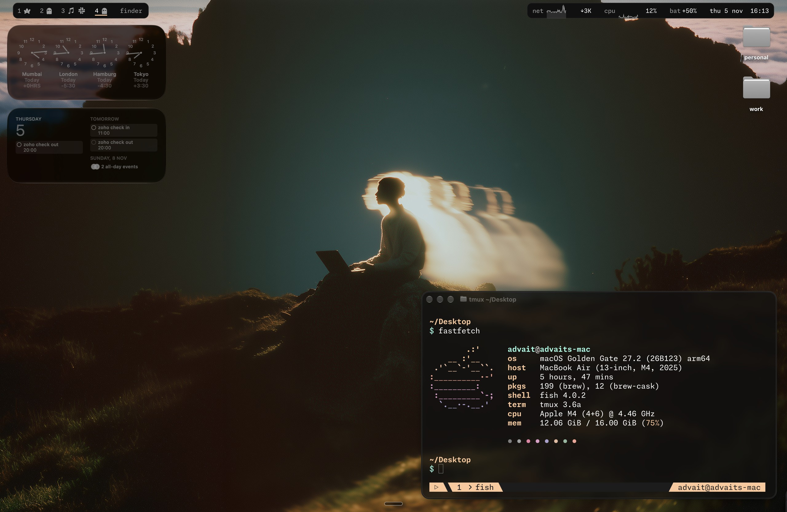
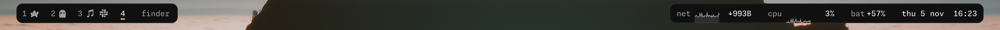
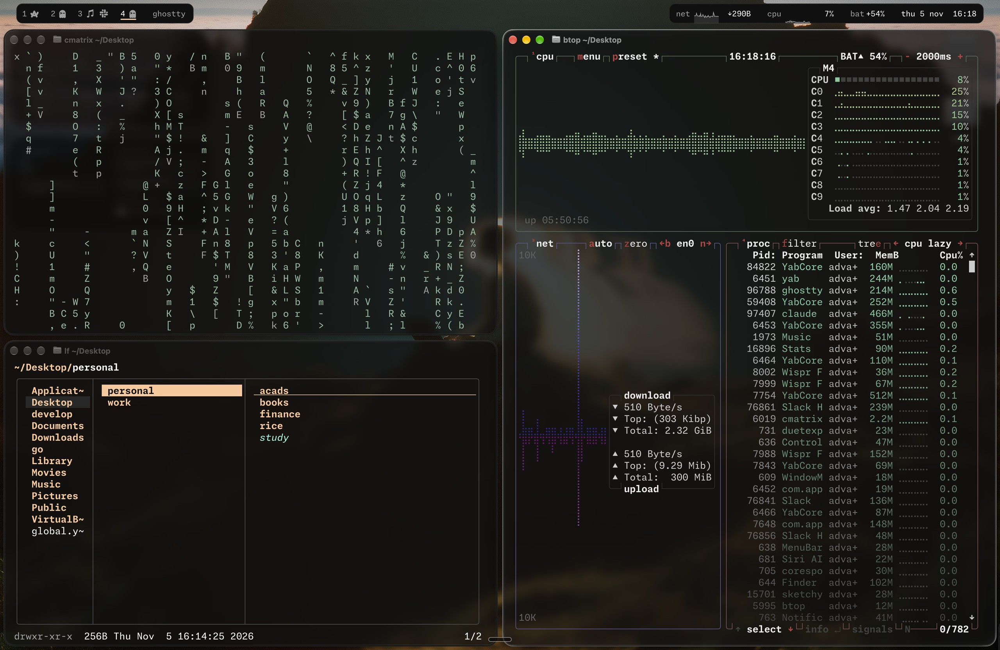
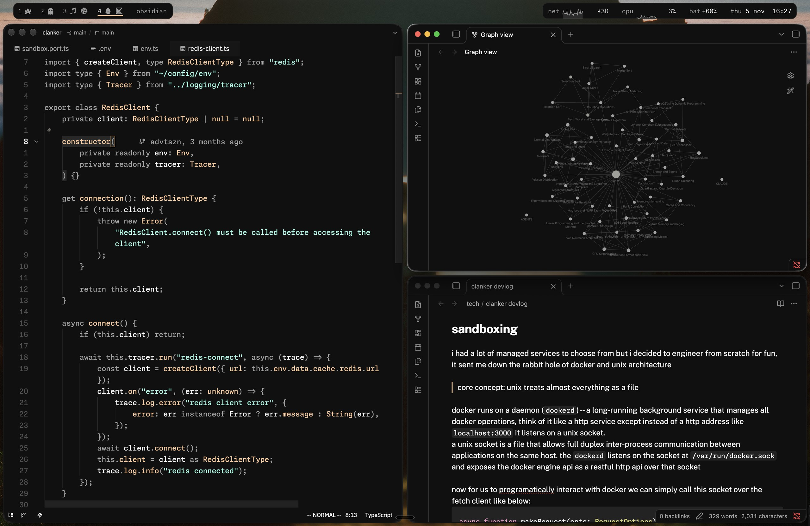
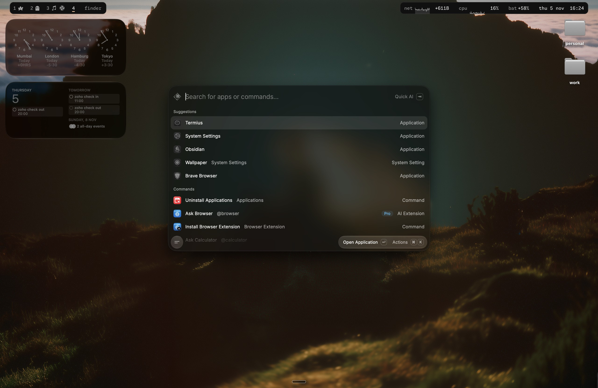

# dotfiles

My macOS rice: **Vesper** colours everywhere, **Rift** tiling, a two-island **SketchyBar** around the notch, and **JankyBorders**.
Managed with [chezmoi](https://www.chezmoi.io/), guarded by [gitleaks](https://github.com/gitleaks/gitleaks).





<table>
  <tr>
    <td></td>
    <td></td>
  </tr>
  <tr>
    <td colspan="2" align="center"></td>
  </tr>
</table>

## What's in here

|                | Tool                                                                                                            | Config                                                     |
| -------------- | --------------------------------------------------------------------------------------------------------------- | ---------------------------------------------------------- |
| Window manager | [Rift](https://github.com/acsandmann/rift) — BSP tiling, virtual workspaces, 3-finger swipes                    | `.config/rift/config.toml`                                 |
| Bar            | [SketchyBar](https://github.com/FelixKratz/SketchyBar) — workspaces + app icons, net/cpu graphs, battery, clock | `.config/sketchybar/`                                      |
| Borders        | [JankyBorders](https://github.com/FelixKratz/JankyBorders)                                                      | `.config/borders/bordersrc`                                |
| Terminal       | [Ghostty](https://ghostty.org) — Vesper, blur, Monaspace Neon                                                   | `Library/Application Support/com.mitchellh.ghostty/config` |
| Shell          | [fish](https://fishshell.com) + [Starship](https://starship.rs) prompt                                          | `.config/fish/`, `.config/starship.toml`                   |
| Multiplexer    | tmux + [tmux-nova](https://github.com/o0th/tmux-nova)                                                           | `.tmux.conf`                                               |
| Editor         | [Zed](https://zed.dev) — Vesper, vim mode, decluttered UI                                                       | `.config/zed/`                                             |
| Files          | [lf](https://github.com/gokcehan/lf), [lsd](https://github.com/lsd-rs/lsd)                                      | `.config/lf/`, `.config/lsd/`                              |
| Fetch          | [fastfetch](https://github.com/fastfetch-cli/fastfetch)                                                         | `.config/fastfetch/`                                       |
| Packages       | Homebrew bundle                                                                                                 | `.Brewfile`                                                |
| Wallpapers     |                                                                                                                 | `.config/wallpapers/`                                      |

**Palette** — [Vesper](https://github.com/raunofreiberg/vesper):
`#101010` background · `#ffffff` text · `#ffc799` peach · `#99ffe4` mint · `#ff8080` red · `#a0a0a0` grey · `#505050` dim

**Font** — [Monaspace Neon](https://monaspace.githubnext.com) with texture healing and ligatures.

## Keys

Window management is all `⌥` (Option). Caps Lock is a Raycast Hyper key for launching apps.

| Keys                                            | Action                                    |
| ----------------------------------------------- | ----------------------------------------- |
| `⌥ 1–5`                                         | switch workspace                          |
| `⌥⇧ 1–5`                                        | send window to workspace                  |
| `⌃ ←` / `⌃ →` · 3-finger swipe                  | previous / next workspace                 |
| `⌥ H J K L`                                     | focus left / down / up / right            |
| `⌥⇧ H J K L`                                    | move window                               |
| `⌥ =` / `⌥ -` · `⌥⇧ =` / `⌥⇧ -`                 | wider / narrower · taller / shorter       |
| `⌥ /`                                           | flip split direction                      |
| `⌥ ,`                                           | stack windows                             |
| `⌥ F` · `⌥⇧ F`                                  | fullscreen (keep gaps) · edge to edge     |
| `⌥⇧ Space`                                      | float at a sensible size / back to tiling |
| `⌥ Tab`                                         | last workspace                            |
| `⌥⇧ ;` then `R` / `F` / `⌥⇧ HJKL` / `U` / `Esc` | balance / float / join / unjoin / reload  |

## New machine

```sh
xcode-select --install
/bin/bash -c "$(curl -fsSL https://raw.githubusercontent.com/Homebrew/install/HEAD/install.sh)"
brew install chezmoi gitleaks
chezmoi init --apply advtszn      # installs everything in .Brewfile on first apply
```

Then, once:

1. `chsh -s /opt/homebrew/bin/fish` and `fisher update`
2. `rift service install && rift service start` — grant **Accessibility** when asked
3. `brew services start sketchybar && brew services start borders`
4. System Settings:
   - Control Center → **Automatically hide and show the menu bar: Always**
   - Keyboard Shortcuts → Mission Control → untick **Move left/right a space** (Rift uses `⌃ ← →`)
   - Desktop & Dock → keep a single macOS Space (Rift does workspaces)
5. Raycast: Caps Lock → Hyper Key, import settings

## Credits

[Vesper](https://github.com/raunofreiberg/vesper) by Rauno Freiberg · [Rift](https://github.com/acsandmann/rift) by acsandmann · [SketchyBar](https://github.com/FelixKratz/SketchyBar), [JankyBorders](https://github.com/FelixKratz/JankyBorders) by Felix Kratz · [sketchybar-app-font](https://github.com/kvndrsslr/sketchybar-app-font) · wallpapers belong to their original artists:
[PPLX Digital Wallpapers: I](https://perplexity.supply/products/pplx-digital-wallpapers-i) & [wallhaven](https://wallhaven.cc).
